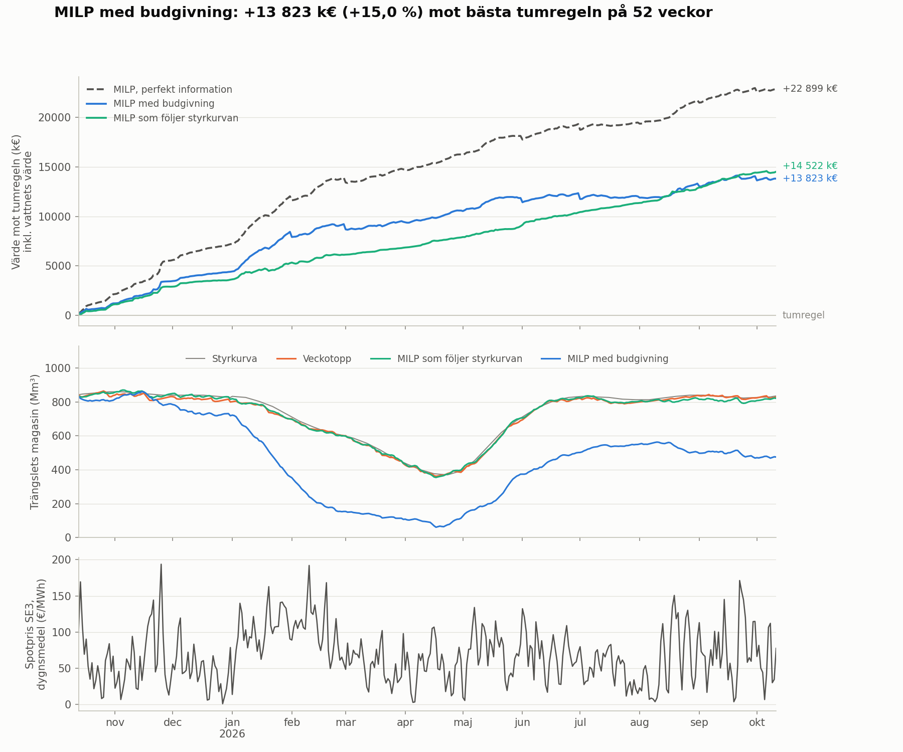
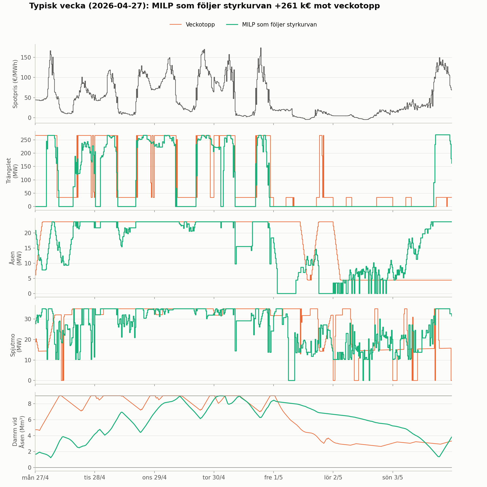
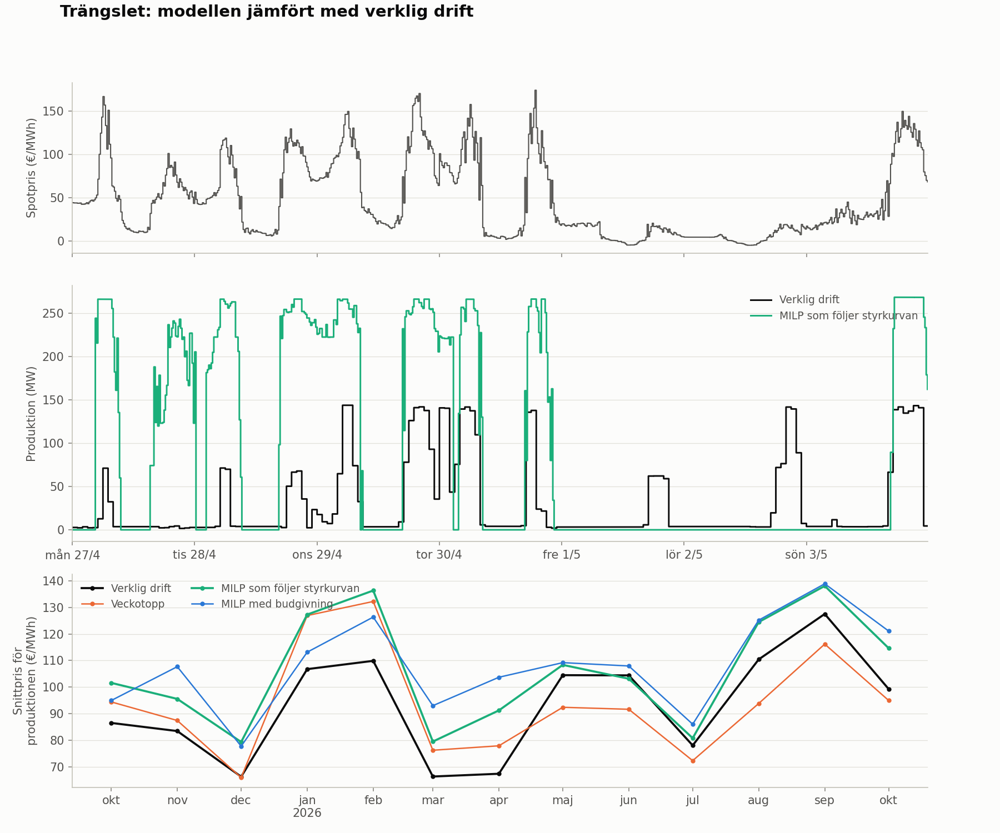
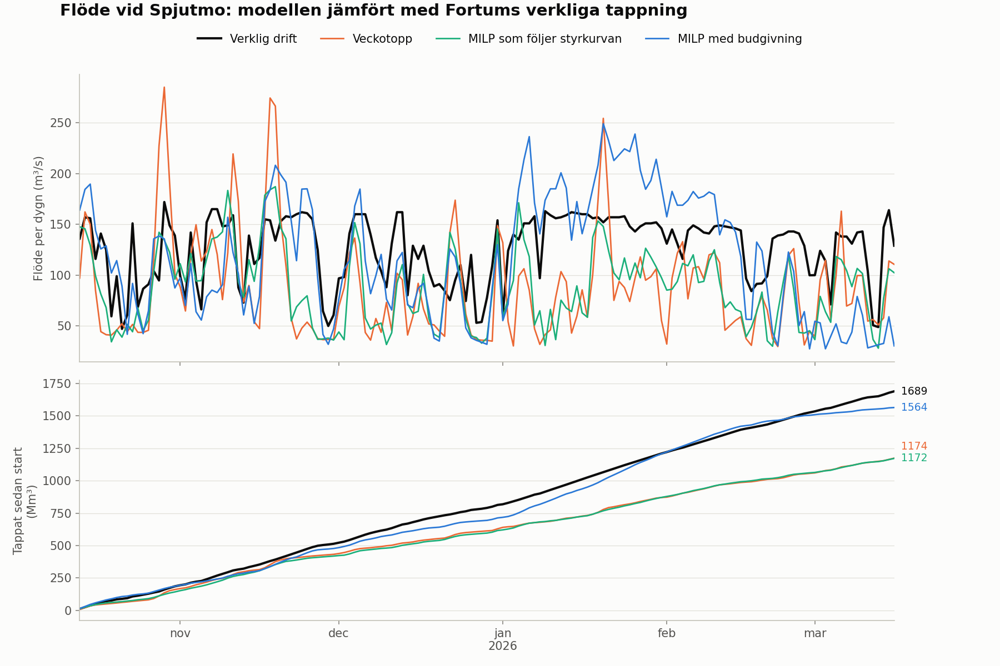
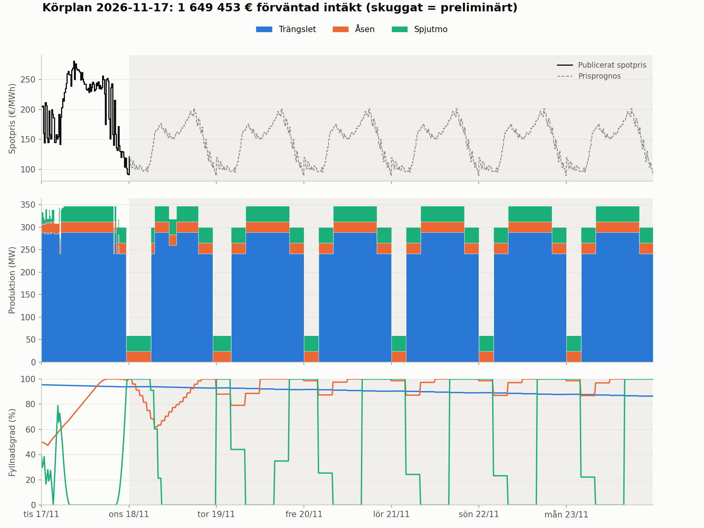
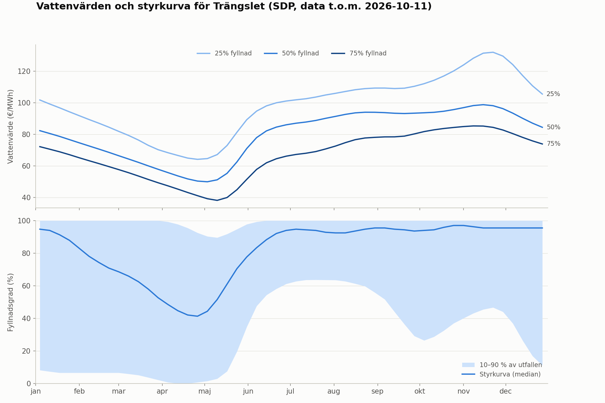

# Korttidsplanering av Trängslet, Åsen och Spjutmo

Hugo Almström, 2026

Planerings- och budgivningsmodell för Fortums kaskad i Österdalälven (SE3), byggd på öppna
data från Nord Pool, eSett, Svenska kraftnät, SMHI och ENTSO-E.

- **Långtid:** vattenvärden och styrkurva för Trängslets magasin med stokastisk dynamisk
  programmering över historiska år där pris och tillrinning hör ihop.
- **Korttid:** MILP (PuLP/HiGHS) per aggregat och kvart, sju dygn framåt, som samoptimerar el
  med FCR-N, FCR-D och mFRR och följer vattendomens regler för Åsen.
- **Budgivning:** tvåstegsmodell över fem prisscenarier ger budkurva och mFRR-volym dagen
  innan; FCR säljs efter day-ahead och avvikelser avräknas mot eSetts verkliga obalanspris.

**Resultat, backtest 13 oktober 2025 – 11 oktober 2026 på verkliga priser och tillrinning:**

| Trängslet | Energi | Snittpris |
|---|---:|---:|
| Fortums verkliga drift (ENTSO-E) | 728 GWh | 93 €/MWh |
| Modellen | 736 GWh | 110 €/MWh |

Mot den bästa av fem tumregler tjänar modellen 13,8 M€ (+15 %) på året. Ren korttidsvinst, på
samma styrkurva som tumregeln, är 14,5 M€ (95 % KI 12,3–17,1 M€), och den håller utan
stödtjänstmarknad. Anläggningsdata är antaganden eller härledda ur offentliga källor, så
metoden är poängen, inte siffrorna. Backtesten är ett år, och modellen har utvecklats mot samma
år, så resultatet kan vara i överkant.



Mer: [kaskaden och källorna](docs/kaskaden.md), [datakällorna](docs/data.md) och
[problem som dök upp under arbetet](docs/problem.md). *In English: see the summary at the end.*

## Resultat: backtest 13 oktober 2025 – 11 oktober 2026

Backtesten använder riktiga spotpriser per kvart (snitt 67 €/MWh), riktiga obalans- och
stödtjänstpriser och riktig tillrinning (102 % av ett normalår). Alla strategier börjar på
styrkurvan, och vattnet som är kvar vid slutet värderas med samma vattenvärden för alla.
Samma vattendomsregler gäller för alla strategier när planerna genomförs, och ingen strategi
bröt minimitappningen vid Åsen under året.

| Strategi | Energi | Snittpris | El | Stödtjänster | Spill | Trängslet vid slut | Netto* |
|---|---:|---:|---:|---:|---:|---:|---:|
| Jämn tappning | 932 GWh | 69 €/MWh | 63,9 M€ | 22,6 M€ | 6 Mm³ | 838 Mm³ | 125,4 M€ |
| Dygnstopp, med tak | 922 GWh | 75 €/MWh | 69,1 M€ | 19,3 M€ | 128 Mm³ | 837 Mm³ | 125,6 M€ |
| Dygnstopp, Trängslet fullt | 906 GWh | 80 €/MWh | 72,6 M€ | 14,8 M€ | 128 Mm³ | 838 Mm³ | 123,8 M€ |
| Veckotopp | 884 GWh | 89 €/MWh | 79,0 M€ | 13,3 M€ | 545 Mm³ | 828 Mm³ | 128,7 M€ |
| Vattenvärdesbud | 1 032 GWh | 101 €/MWh | 104,5 M€ | 8,8 M€ | 1 421 Mm³ | 206 Mm³ | 124,2 M€ |
| MILP som följer styrkurvan | 928 GWh | 98 €/MWh | 91,0 M€ | 14,7 M€ | 279 Mm³ | 821 Mm³ | 143,3 M€ |
| MILP med punktprognos | 988 GWh | 103 €/MWh | 101,5 M€ | 13,0 M€ | 582 Mm³ | 574 Mm³ | 143,5 M€ |
| MILP med budgivning | 1 025 GWh | 103 €/MWh | 105,8 M€ | 11,9 M€ | 562 Mm³ | 475 Mm³ | 142,6 M€ |
| MILP, perfekt information | 1 031 GWh | 106 €/MWh | 109,1 M€ | 17,1 M€ | 476 Mm³ | 487 Mm³ | 151,6 M€ |

\* Netto = el (spot plus obalans) + stödtjänster − startkostnader + värdet av vattnet som är kvar.
Spill är vatten som släpps förbi turbinerna i alla tre kraftverken, nästan allt vid Åsen och
Spjutmo när Trängslet kör mer än Åsen tar emot.

### Vad optimeringen tjänar

Korttidsplaneringen ger 14,5 M€ per år (+15,7 %), med 95 % konfidensintervall 12,3–17,1 M€
(block-bootstrap över veckorna). Jämförelsen görs mot den bästa tumregeln som följer samma
styrkurva, veckotopp, så båda använder lika mycket vatten. Skillnaden består av:

| | M€ |
|---|---:|
| El: snittpris 98 i stället för 89 €/MWh och 44 GWh mer energi, eftersom mindre vatten spills vid Åsen och Spjutmo | +12,0 |
| Stödtjänster: mer ledig kapacitet att sälja | +1,3 |
| Starter: 2 038 i stället för 5 550 | +1,3 |
| Något lägre magasin vid slutet | −0,2 |

Veckotopp lägger Trängslets vatten på veckans dyraste kvartar och kör då fullt, 250 m³/s, men
Åsen tar bara emot 112 m³/s. Optimeringen vet hur länge Åsens damm räcker och kör Trängslet på
dellast när dammen är full. En typisk vecka: MILP kör Trängslet i pristopparna, ofta på dellast
så att det finns marginal att sälja som mFRR upp, och använder Åsens damm från nästan tom till
full. Veckotopp kör Trängslet fullt, på minsta last eller inte alls.



MILP med budgivning får avvika från styrkurvan efter vattenvärdena. Vinterpriserna var höga,
så den tappade ur Trängslet till 61 av 880 Mm³ inför vårfloden och slutade året på 475 Mm³ i
stället för 821. Det gav 0,7 M€ mindre än att följa styrkurvan. Säsongsomfördelningen tjänade
alltså inget det här året, och hela vinsten kommer från korttidsplaneringen. Totalvinsten mot
den bästa av alla tumregler blir 13,8 M€ (+15,0 %), och MILP med budgivning är bättre 44 av 52
veckor.

Prisscenarierna och budkurvan gav inget netto det här året: MILP med budgivning fick 0,9 M€
mindre än samma modell med bara punktprognosen. Budkurvan gjorde det den ska. Avvikelserna mot
budet halverades, från 100 till 46 GWh, och obalanskostnaden föll från 274 000 till 2 000 €.
Men tvåstegsmodellen använde 99 Mm³ mer vatten under året. Elen och stödtjänsterna från det
vattnet gav 3,2 M€, medan vattnet var värt 4,0 M€ med årets slutliga vattenvärden. Skillnaden
är alltså främst säsongsplanering och beror på vattenvärdena, inte på budgivningen.

Perfekt information hade gett 9,1 M€ till, och 5,2 M€ av det är stödtjänster. mFRR-kapacitet
säljs innan priset är känt, och den som vet i vilka timmar kaskaden ska köra fullt kan sälja
resten utan risk.

### Drift och kontroller

- Avvikelserna mot budet var 46 GWh, 4,5 % av energin. Jämfört med att sälja till spotpris
  kostade de 2 000 € för MILP med budgivning och gav 42 000 € för MILP som följer styrkurvan.
- Minimitappningen vid Åsen klarades alla timmar av alla 30 strategierna.
- Stödtjänsterna var 10 % av intäkten. Av de 1 177 GWh stödtjänster som MILP med budgivning
  sålde gick 554 MWh, 0,05 %, inte att leverera med utfallet, och då betalas de inte.
- MIP-gapet i de 1 456 leveransoptimeringarna var i median 0,20 % och över 1 % i 266 (18 %),
  där tidsgränsen på 120 sekunder nåddes. Gapet räknas mot målfunktionen, som är veckans intäkt
  minus värdet av vattnet som används, 0,4–3,3 M€ i de 15 dygn som löstes om för att mäta det.
  I euro var gapet i medel 4 000 € per veckoplan när det var under 1 % och cirka 20 000 € vid
  2–4 %. Det största var 130 000 € (31 juli; samma dygn löst igen med färre parallella
  körningar gav 0,7 %). Summerat över årets planer för MILP med budgivning är gränsen cirka
  3 M€, men bara första dygnet av varje plan genomförs. Med längre tidsgräns blir gapet mindre
  och körtiden längre.

### Känslighet

Totalvinst mot den bästa tumregeln med samma antagande för båda, och den lägsta nivån i
Trängslet under året:

| Antagande | Merintäkt | Bästa tumregel | Lägsta nivå |
|---|---:|---|---:|
| Basfall | 13,8 M€ (+15,0 %) | Veckotopp | 61 Mm³ |
| Vattenvärde −20 % | 11,7 M€ (+12,7 %) | Veckotopp | 0 Mm³ |
| Vattenvärde +20 % | 15,7 M€ (+14,0 %) | Vattenvärdesbud | 160 Mm³ |
| Startkostnad −50 % | 13,0 M€ (+14,0 %) | Veckotopp | 63 Mm³ |
| Startkostnad +100 % | 15,4 M€ (+16,7 %) | Veckotopp | 54 Mm³ |
| Riskaverta vattenvärden | 13,3 M€ (+14,4 %) | Veckotopp | 77 Mm³ |
| Halverat tak för stödtjänster | 15,8 M€ (+18,3 %) | Veckotopp | 43 Mm³ |
| Utan stödtjänster | 17,4 M€ (+16,6 %) | Vattenvärdesbud | 43 Mm³ |
| Utan stödtjänster, bara korttidsvinst | 15,5 M€ (+19,7 %) | Veckotopp | 352 Mm³ |

- Vinsten ligger mellan 11,7 och 17,4 M€ i alla varianter.
- Den kommer inte från stödtjänsterna. Utan stödtjänstmarknad blir korttidsvinsten 15,5 M€,
  mot 14,5 M€ i basfallet, eftersom tumreglerna tappar mer på att inte kunna sälja sin lediga
  kapacitet. Det mesta kommer från när elen produceras och hur stationerna samordnas.
- De riskaverta vattenvärdena räknas med CVaR: hälften av vikten ligger på medelvärdet av de
  sämsta 20 % av utfallen. De gav nästan samma vinst och lämnade lite mer vatten i magasinet,
  77 mot 61 Mm³ som lägst.
- Med vattenvärdena tappar optimeringen ur Trängslet till 0–160 Mm³ före vårfloden. Det är
  Fortums vanliga drift: enligt SMHI:s mätningar tappades magasinet ur med i median 752 Mm³
  före vårfloden 1997–2025 (se Validering).

### Validering mot verkligheten

**Produktion per kraftverk.** Strategierna som följer styrkurvan producerar 631–662 GWh i
Trängslet, 116–131 GWh i Åsen och 135–151 GWh i Spjutmo. Fortums normalår är 651, 117 och 138
GWh, och tillrinningen var 102 % av normalt. Avrinningsområdena är satta efter SMHI:s uppmätta
flöde och verkningsgraden i Trängslet efter ENTSO-E (se [kaskaden](docs/kaskaden.md)), men
fallhöjd, spill och drift kommer från modellen.

**Trängslets verkliga produktion.** ENTSO-E publicerar produktionen per aggregat för Trängslet
(G1–G3), och den finns för alla kvartar i backtesten:

| | Energi | Snittpris | Andel i dyraste kvartilen | Korrelation med pris |
|---|---:|---:|---:|---:|
| Verklig drift (ENTSO-E) | 728 GWh | 93 €/MWh | 42 % | 0,60 |
| Veckotopp | 633 GWh | 94 €/MWh | 42 % | 0,41 |
| MILP som följer styrkurvan | 661 GWh | 105 €/MWh | 51 % | 0,62 |
| MILP med budgivning | 736 GWh | 110 €/MWh | 58 % | 0,76 |

MILP med budgivning producerar nästan lika mycket som Fortum och lägger mer av produktionen i
de dyra timmarna. Magasin och tillrinning skiljer sig mellan modell och verklighet, och Fortum
använder Trängslet också för frekvensreglering, så energin är inte direkt jämförbar. Men
fördelningen över dyra och billiga timmar är det.



**Fortums verkliga tappning.** SMHI mäter flödet vid Spjutmo kraftverk per dygn sedan 1996, alltså
det som tappats genom kaskaden plus den lokala tillrinningen. Under backtesten finns mätningar
till och med 16 mars 2026:

- Fortum tappade 1 689 Mm³, MILP med budgivning 1 564 Mm³ och strategierna som följer
  styrkurvan cirka 1 170 Mm³.
- Korrelationen med den verkliga tappningen per dygn är 0,62 för MILP med budgivning, 0,49 för
  MILP som följer styrkurvan och 0,32 för veckotopp.
- Fortum tappar ur Trängslet mer än styrkurvan: i median 752 Mm³ före vårfloden 1997–2025, och
  mer än 80 % av magasinet 69 % av åren. Styrkurvan tappar ur 490 Mm³. Länsstyrelsen beskriver
  samma sak: "Under vintern töms Trängslets magasin ned mot sänkningsgränsen."

Styrkurvan från SDP:n är alltså försiktigare än Fortums drift, och MILP med vattenvärdena
liknar verkligheten mer än strategierna som följer styrkurvan.



### Skarp körplan

För tisdagen den 17 november 2026 låg spotpriset mellan 101 och 265 €/MWh per timme, och
vattenvärdet vid styrkurvan var 71 €/MWh. Priset ligger långt över vattenvärdet hela dygnet,
så planen kör Trängslet nästan fullt till kl. 23, även när Åsens damm är full och överskottet
spills där: el från Trängslet för över 100 €/MWh är värd mer än det Åsen och Spjutmo hade
fått ut av samma vatten senare. Förväntad intäkt är 1 649 000 € för el, med snittpriset
210 €/MWh, och 5 000 € för stödtjänster, eftersom nästan ingen kapacitet blir ledig. Resten av
veckan bygger på en prisprognos.



## Kör

```
pip install -r requirements.txt
python run.py                                          # backtest de senaste 4 veckorna
python run.py --weeks 52                               # helår
python run.py --weeks 52 --sensitivity                 # därtill känslighetsanalys
python run.py --weeks 52 --sensitivity --slut 2026-10-12   # exakt perioden ovan
python run.py --weeks 52 --slut 2026-10-12 --verklig  # därtill jämförelse med verklig drift
python run.py --plan                                   # körplan för nästa dygn med publicerade priser
python run.py --plan --magasin 700,1.5,2               # utgå från aktuella volymer (Mm³)
python -m pytest                                       # 70 tester
```

Jämförelsen med verklig drift hämtar Trängslets produktion per aggregat från ENTSO-E:s
transparensplattform. Det kräver en gratis API-nyckel: registrera ett konto på
[transparency.entsoe.eu](https://transparency.entsoe.eu/), mejla transparency@entsoe.eu med
ämnet "Restful API access" och lägg nyckeln i miljövariabeln `ENTSOE_API_KEY` eller i filen
`data_cache/entsoe_token.txt`.

Data hämtas från öppna API:er vid första körningen och sparas i `data_cache/`, som inte ingår
i repot. Där sparas också vattenvärdena, som räknas parallellt för varje månad, och
backtestens läge efter varje vecka, så att en avbruten körning fortsätter där den slutade.
Sparpunkterna gäller bara så länge modellens kod är oförändrad. Helåret med
känslighetsanalys, 30 strategier, tar ungefär två dygn på en bärbar dator med 12 trådar: varje
MILP-strategi tar 15–50 minuter per simulerad vecka, mest på sommaren när Åsen inte får
korttidsreglera, medan tumreglerna tar några minuter för hela året. Datorn får inte gå i
viloläge under tiden. Tabeller och figurer hamnar i `resultat/`.

## Kaskaden i korthet

| | Trängslet | Åsen | Spjutmo |
|---|---:|---:|---:|
| Effekt | 300 MW | 24 MW | 35 MW |
| Fallhöjd | 142 m | 24 m | 21,4 m |
| Magasin | 880 Mm³ | cirka 9 Mm³ | ingen egen reglering |
| Maxflöde | 250 m³/s | 112 m³/s | 185 m³/s |
| Vattendom | – | min 21 m³/s, högst 30 m³/s/h, ingen korttidsreglering juni–augusti | följer Åsen |

Åsen tar emot mindre än hälften av vad Trängslet kan släppa och får inte korttidsregleras på
sommaren. Körs Trängslet fullt längre än Åsens damm räcker spills vatten vid Åsen, så
samordningen mellan stationerna betyder mycket. Alla parametrar, källor och kalibreringen mot
SMHI och ENTSO-E finns i [docs/kaskaden.md](docs/kaskaden.md).

## Modellen

### Långtidsplanering: vattenvärden och styrkurva (SDP)

[watervalues.py](watervalues.py) räknar vad vattnet i Trängslet är värt beroende på vecka och
fyllnadsgrad, med ett steg per vecka, cykliskt över året:

```
F_k(V) = E[ max_V' { intäkt_k(X, V, V') − straff(X < Xmin) + β · F_k+1(V') } ],   X = V + I − V'
```

- Intäkten räknas med veckans varaktighetskurva för priset. Vatten upp till kaskadens
  flaskhals (Åsen) ger effekt i alla tre kraftverken under veckans dyraste timmar, vatten
  därutöver bara i Trängslet. 1 juni–31 augusti får Åsen och Spjutmo inte korttidsreglera, och
  då får deras del av effekten veckans medelpris.
- Fallhöjden beror på magasinsnivån, så ett fullt magasin ger mer el per m³.
- Xmin är tappningen som krävs för vattendomens minimitappning nedströms.
- Osäkerheten kommer från historiska år sedan elområdesindelningen 2011 där både spotpriser
  och tillrinning finns, i dag 2012–2025. Pris och tillrinning från samma år hör ihop, så
  sambandet mellan våta år och låga priser följer med. Varje år ger fem prisscenarier per
  vecka: samma vecka och de två närmaste på vardera sidan. Alla år skalas med samma faktor
  till det senaste årets prisnivå, så skillnaderna mellan åren behålls.
- I backtesten räknas allt om vid varje månadsskifte med den data som fanns då, så ingen
  framtida information läcker in.
- Styrkurvan är medianen när den optimala policyn simuleras genom alla år och prisscenarier.



### Korttidsplanering (MILP)

[model.py](model.py) optimerar sju dygn framåt. För kraftverk *p*, aggregat *u*, tidsblock *b*
och segment *k* på produktionskurvan:

```
max   Σ d_b · pris_b · P_pub  +  Σ d_b · reservpris_bi · R_bi  −  Σ startkostnad · start_pub
      +  Σ_p F_p(V_p,slut)  −  straff · |P_b − åtagande_b|

P_pub = h_p · (Pmin_u · z_pub + Σ_k e_k · q_pubk)    effekt; h_p = fallhöjdsfaktor, z_pub ∈ {0,1}
Q_pub = Qmin_u · z_pub + Σ_k q_pubk                  flöde; q_pubk ≤ bredd_k · z_pub
start_pub ≥ z_pub − z_pu(b−1)                        start när aggregatet går från 0 till 1
V_pb  = V_p(b−1) + c · d_b · (lokal tillrinning + ankomst från ovan − R_pb)
R_pb  = Σ_u Q_pub + spill_pb ≥ minimitappning_p       (mjukt villkor, högt straff)
0 ≤ V_pb ≤ Vmax_p
```

Stödtjänsterna R (FCR-N, FCR-D upp/ned, mFRR upp/ned) ska rymmas i varje kraftverks
marginaler:

```
P + FCR-N + FCR-D upp            ≤ h · Pmax · (aggregat i drift)
P + FCR-N + FCR-D upp + mFRR upp ≤ h · Pmax · (alla aggregat)      vattenkraft startar på minuter
P − FCR-N − FCR-D ned            ≥ h · Pmin · (aggregat i drift)
P − FCR-N − FCR-D ned − mFRR ned ≥ 0                               aggregaten kan stoppas
FCR-N ≤ 10 %, FCR-D ≤ 20 % av kapaciteten i drift
```

Vattenhushållningsbestämmelserna för Åsen är villkor på tappningen R = Q + spill:

```
R_b >= 21 m³/s                                       hela året (minimitappning)
|R_b - R_b-1| <= 30 m³/s per timme                   1 september–31 maj
R_b = R_b-1 inom dygnet, högst 40 m³/s mellan dygn    1 juni–31 augusti (ingen korttidsreglering)
```

De är mjuka villkor med högt straff, så att det alltid finns en plan, och straffet för en
ändring mellan dygn räknas för hela dygnet som nivån gäller. Samma regler gäller när planen
genomförs, för alla strategier: tumreglernas tappning från Åsen jämnas ut innan den körs.
Spjutmo har ingen egen reglering och följer Åsen.

- Tidsblocken är kvartar första dygnet (day-ahead-marknadens upplösning), timmar andra dygnet
  och fyratimmarsblock därefter. Stödtjänsterna är konstanta inom timmen.
- Vatten som släpps från ett kraftverk fördelas med gångtiden på de block där det når nästa
  kraftverk.
- F_p värderar slutvolymen. För Trängslet är det SDP:ns konkava, styckvis linjära funktion,
  för dammarna en flack kurva runt halvfull. Målfunktionen räknar förändringen i vattnets
  värde, så att MIP-gapet får rätt skala.
- Produktionskurvan är konkav ovanför minsta last (koden kontrollerar det), så binära
  variabler behövs bara för drift och stopp.
- HiGHS löser med en tråd och en tidsgräns per optimering. Avbryts en lösning av ett numeriskt
  fel görs nya försök med andra slumpfrön.

### Budgivning, stödtjänster och avräkning

Varje dygn i backtesten ([backtest.py](backtest.py)) går till så här:

1. mFRR-kapacitet och elbud dagen innan. Fem prisscenarier skapas: prognosen plus verkliga
   prognosfel från de senaste fyra veckorna, från det minsta till det största. De löses i en
   tvåstegsmodell, en MILP där varje scenario har sin egen körplan men mFRR-volymen är
   gemensam, eftersom den säljs innan priset är känt. Produktionen första dygnet får aldrig
   vara lägre i ett scenario med högre pris, så scenariernas körplaner är direkt en budkurva
   per kvart. Målet är det förväntade värdet, så reservintäkten vägs mot vad den kostar i
   förlorad flexibilitet. Under det lägsta scenariots pris sjunker budet till noll vid
   vattenvärdet.
2. Clearing. Det verkliga spotpriset avgör åtagandet per kvart.
3. FCR och leverans. Planen optimeras om mot åtagandet med dygnets priser kända, och FCR säljs
   då, som i Svenska kraftnäts upphandling efter day-ahead. Planen genomförs mot den faktiska
   tillrinningen. Avviker utfallet reagerar driften som en operatör: fullt magasin ger mer
   tappning och sedan spill, tomt magasin mindre tappning.
4. Avräkning. Åtagandet betalas med spotpriset och avvikelser med eSetts verkliga
   obalanspris. Stödtjänster betalas med det verkliga kapacitetspriset, men bara för den del
   som gick att leverera med utfallet. Det sålda prövas mot kaskadens samlade marginaler,
   FCR-N först, sedan FCR-D och sist mFRR.

Tumreglerna säljer den kapacitet som blir ledig enligt deras plan och kontrolleras på samma
sätt. Kaskaden får sälja högst en fjärdedel av den volym elområdet har upphandlat (median
över de senaste fyra veckorna).

### Prognoser

- Spotpris: dygnets form är snittet för samma kvart de senaste sju dygnen plus senaste kända
  avvikelse, som klingar av med 10 % per timme. Dygnets nivå kommer från en linjär regression
  på samma kvart i går och förra veckan, veckoprofilen, gårdagens medelpris och kväll samt
  veckodag, skattad på de senaste åtta veckorna. Nivåkorrigeringen halveras för varje dygn
  längre fram. Mellan oktober 2025 och oktober 2026 gav det ett medelfel på 23,0 €/MWh för
  nästa dygn (25,3 utan nivåmodellen), när snittpriset var 67 €/MWh.
- Stödtjänstpriser: samma metod, per timme.
- Tillrinning: säsongsnormalen plus senaste observerade avvikelse från den, som klingar av med
  2 % per dygn. Normalen är medlet för samma dag på året från åren före prognosen. Då syns
  vårflodens början i prognosen, medan ett ovanligt vått eller torrt läge består. Avklingningen
  valdes på 2000–2012, och på 2013–2025 gav metoden 10 % lägre medelfel än persistens (att
  senaste dygnsmedel består) för Trängslets tillrinning 1–7 dygn framåt.

### Strategierna

| Strategi | Beskrivning |
|---|---|
| Jämn tappning | Samma flöde varje kvart, enligt styrkurvan |
| Dygnstopp, med tak | Fullt under dygnets dyraste kvartar enligt prisprognosen, men aldrig mer än stationen nedströms tar emot |
| Dygnstopp, Trängslet fullt | Samma, men Trängslet körs fullt och överskottet spills vid Åsen |
| Veckotopp | Trängslets vatten för veckan läggs på veckans dyraste kvartar enligt prognosen |
| Vattenvärdesbud | Följer inte styrkurvan. Trängslet bjuder upp till Åsens kapacitet när priset är minst vattenvärdet och fullt när det lönar sig trots spill vid Åsen. Samma vattenvärden som MILP |
| MILP med budgivning | Hela modellen |
| MILP med punktprognos | Samma, men med bara prisprognosen i stället för fem scenarier. Visar vad scenarierna och budkurvan tillför |
| MILP som följer styrkurvan | Samma som MILP med budgivning, men Trängslet hålls inom ±1 % av styrkurvan. Ger ren korttidsvinst utan säsongsomfördelning |
| MILP, perfekt information | Känner priser och tillrinning i förväg och är ett tak |

De fyra första reglerna följer styrkurvan. Alla tumregler säljer stödtjänster och tar hänsyn
till gångtiden och till minimitappningen nedströms, med marginal för att den lokala
tillrinningen blir lägre än prognosen. Är flödet för minimitappningen mindre än minsta last i
Trängslet körs ett aggregat på minsta last en del av dygnet, och Åsens damm jämnar ut. Så kör
Fortum enligt Länsstyrelsen, med "en eller två turbiner på låg tappning under nätter och
helger". Planen provkörs mot prognosen, och räcker inte dammen släpps flödet förbi turbinen.
Två jämförelser görs, båda mot den regel som gick bäst, så att vinsten inte överskattas:
- Korttidsvinsten: MILP som följer styrkurvan mot den bästa regeln som följer styrkurvan.
- Totalvinsten: MILP med budgivning mot den bästa av alla regler.

Datakällorna beskrivs i [docs/data.md](docs/data.md).

## Antaganden och begränsningar

- Backtesten omfattar ett år, och modellen har utvecklats och felsökts mot samma år (se
  [problem som dök upp](docs/problem.md)). Några parametrar är dessutom kalibrerade på
  perioden: Trängslets verkningsgrad mot ENTSO-E vintern 2025/26 och obalansstraffet i
  budgivningen mot eSetts priser under året. Resultatet kan därför vara i överkant, och nästa
  steg är att köra ett andra år med oförändrad kod.
- Antal aggregat, verkningsgrader, dammvolymer, gångtider, minimitappning och
  regleringsgränser är antaganden eller härledda ur offentliga källor. Med Fortums interna data
  ändras siffrorna men inte metoden. Trängslets egna vattenhushållningsbestämmelser utöver
  0–880 Mm³ och 0–250 m³/s ingår inte.
- FCR-andelarna (10 % respektive 20 % av kapaciteten i drift) och taket på en fjärdedel av
  elområdets upphandling är antaganden, och kaskaden antas vara pristagare. Aktiveringsenergi,
  aFRR och krav på förkvalificering ingår inte.
- Prisprognosen bygger bara på historiska priser, med ett medelfel på 23 €/MWh för nästa
  dygn. En prognos med väder och vind ger bättre bud, så resultaten är snarare i underkant.
- Tillrinningsprognosen bygger på säsongsnormalen och senaste avvikelse. Snömagasinet, som är
  viktigt för vårflodsprognosen i ett fjällmagasin, ingår inte.
- Budgivningen använder fem prisscenarier. Fler ger finare budkurvor men längre beräkningstid.
- Åsens kapacitet (112 m³/s) är härledd ur effekt och fallhöjd, och dammens storlek (9 Mm³) ur
  att den räcker till minimitappningen i fem dygn.
- Sommarregeln för Åsen är förenklad. Vattendomen tillåter ändringar på högst 10 m³/s per
  timme och 40 m³/s per dygn, men inte "upp och ned" inom 72 timmar. Modellen håller i stället
  samma tappning hela dygnet och ändrar högst 40 m³/s mellan dygn.
- Tumreglerna har en fördel: i vattenvärdesbudet lägger kraftverken nedströms sitt vatten
  efter dygnets verkliga priser. Det gör jämförelsen försiktig.
- Hela Trängslets regleringsvolym får användas. Med vattenvärdena tappar optimeringen ur
  magasinet till 0–160 Mm³ inför vårfloden. Det stämmer med Fortums drift (se Validering), men
  med en sen eller liten vårflod är det en risk. En marginal sänker säsongsvinsten men inte
  korttidsvinsten, som räknas mot styrkurvan.
- MIP-gapet är inte noll, eftersom varje optimering har en tidsgräns. Gapet redovisas i euro
  under Drift och kontroller.

## Nästa steg

1. Ett andra backtestår med oförändrad kod, som test av att vinsten inte är anpassad till
   2025/26.
2. En prisprognos med ENTSO-E:s prognoser för vind och last, och scenarier från den i stället
   för historiska fel.
3. Intradaghandel för att justera efter prognosmissar i stället för att betala obalans.
4. aFRR, och aktiveringsenergi för mFRR.
5. Fler aggregatdetaljer: verkningsgradskurvor per aggregat, förbjudna driftområden och
   ramper.
6. En tillrinningsprognos med snömagasinet, och risk mätt på magasinsnivån inför vårfloden i
   stället för på intäkten.
7. Kortare lösningstider, till exempel med varmstart från gårdagens plan eller ett heltal för
   antal aggregat i drift i stället för en binär variabel per aggregat, så att MIP-gapet blir
   mindre inom samma tidsgräns.

## Filer

| Fil | Innehåll |
|---|---|
| [cascade.py](cascade.py) | Trängslet, Åsen och Spjutmo: aggregat, magasin, fallhöjd, vattendomens regler |
| [watervalues.py](watervalues.py) | Långtidsplanering: vattenvärden och styrkurva med SDP |
| [model.py](model.py) | Korttidsplanering: MILP-modellen och tvåstegsmodellen (PuLP + HiGHS) |
| [forecast.py](forecast.py) | Pris- och tillrinningsprognoser, prisscenarier för budgivning |
| [heuristics.py](heuristics.py) | Tumreglerna: jämn tappning, dygnstopp, veckotopp, vattenvärdesbud |
| [simulation.py](simulation.py) | Genomförande mot faktisk tillrinning, vattendomens regler, leveranskontroll för stödtjänster |
| [backtest.py](backtest.py) | Strategier, budgivning, stödtjänster, avräkning och sparpunkter |
| [data.py](data.py) | Spotpriser, obalanspriser, stödtjänster, tillrinning, verklig tappning och produktion (ENTSO-E) |
| [run.py](run.py) | Backtest, validering mot verklig drift, skarp plan och rapport |
| [plot.py](plot.py) | Figurer |
| [tests/](tests/) | Vattenbalans, gränser, vattendomens regler, konkavitet, fallhöjd, budkurvor, prognoser, SDP och CVaR, stödtjänster, tumregler, lösarfel, ENTSO-E-svar, MILP mot simulering. Körs på GitHub vid varje push |
| [docs/](docs/) | Kaskaden med källor, datakällor och problem som dök upp under arbetet |
| [v1_enkel/](v1_enkel/) | Första versionen: ett kraftverk, ren LP, syntetiska data |

## Summary in English

A planning and bidding model for Fortum's Trängslet, Åsen and Spjutmo hydropower cascade on
the Österdalälven river (bidding zone SE3), built on public data. Stochastic dynamic
programming over historical price and inflow years gives water values and a guide curve. A
MILP in PuLP/HiGHS plans each day seven days ahead, per unit and quarter-hour, co-optimises
energy with FCR-N, FCR-D and mFRR, and respects the water-court rules for minimum flow and
ramping at Åsen. Day-ahead bids come from a two-stage stochastic MILP over five price
scenarios with a monotone bid curve and a shared mFRR volume, and deviations are settled at
real eSett imbalance prices.

In a backtest on real data from 13 October 2025 to 11 October 2026 the model's Trängslet
production (736 GWh) is close to the 728 GWh Fortum reported to ENTSO-E, at a higher average
price (110 vs 93 €/MWh). Against the best of five rules of thumb the model earns 13.8 M€
(+15.0 %) more; short-term planning alone, on the same guide curve as the rule, earns 14.5 M€
(+15.7 %, 95 % CI 12.3–17.1 M€), and the gain holds without any reserve market. Following the
water values instead of the guide curve cost 0.7 M€ that year, price scenarios with a bid
curve did not beat a point forecast (−0.9 M€), and perfect foresight would have added another
9.1 M€. The backtest covers one year, which the model was also developed against, so the
result may be on the high side. Plant parameters are assumptions or derived from public
sources. The rest of this README, the comments and the output are in Swedish.

## Licens

MIT, se [LICENSE](LICENSE).
