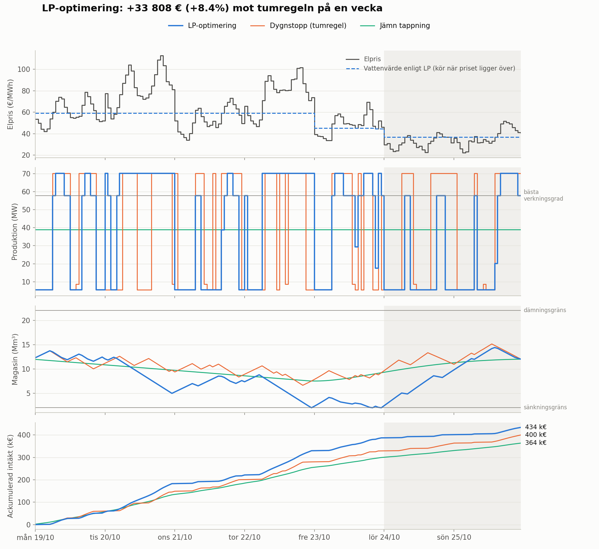

# Veckoplanering av ett vattenkraftverk med linjärprogrammering

Första versionen av projektet: ett kraftverk, ren LP och syntetiska data. Huvudmodellen i
[mappen ovanför](../README.md) bygger vidare på den med en kaskad, aggregat, riktiga data,
budgivning och stödtjänster.

Modellen bestämmer timme för timme hur mycket vatten ett kraftverk ska köra genom turbinen
under en vecka, så att intäkten från spotmarknaden blir så stor som möjligt givet elpriser,
tillrinning och magasinets gränser. Optimeringen (PuLP + HiGHS) jämförs med två tumregler som
får använda lika mycket vatten, så skillnaden i intäkt beror bara på när och hur vattnet körs.



## Resultat

Syntetisk höstvecka i SE2 (`python run.py`), kraftverk på 70 MW med ett magasin på 2–22 Mm³:

| Strategi | Energi (MWh) | Snittpris (€/MWh) | Intäkt (€) |
|---|---:|---:|---:|
| Jämn tappning | 6 547 | 55,6 | 363 834 |
| Dygnstopp (tumregel) | 6 375 | 62,8 | 400 120 |
| LP-optimering | 6 428 | 67,5 | 433 928 |

LP-optimeringen tjänar 33 800 € mer än tumregeln under veckan (+8,4 %). Ungefär 30 500 € kommer
från bättre timing (snittpriset blir 4,7 €/MWh högre) och 3 300 € från högre verkningsgrad,
53 MWh mer el ur samma vatten.

Över 100 slumpade veckor (`python run.py --scenarios 100`):

| LP jämfört med | Snitt €/vecka | Snitt | Min | Max | ≈ per år |
|---|---:|---:|---:|---:|---:|
| Jämn tappning | 71 686 | 18,9 % | 11,8 % | 28,1 % | 3,7 M€ |
| Dygnstopp (tumregel) | 32 565 | 7,8 % | 3,5 % | 14,3 % | 1,7 M€ |

### Var vinsten kommer ifrån

1. Mellan dagar. Tumregeln delar veckans vatten lika per dygn. LP sparar vatten från den
   billiga helgen och kör mer på de dyra vardagarna, så magasinet används som ett veckolager.
2. Verkningsgrad. Tumregeln kör på fullt flöde (200 m³/s) under topptimmarna. Över bästa
   verkningsgrad (160 m³/s) ger varje extra m³ ungefär 14 % mindre el, så LP går upp på fullt
   bara när priset är tillräckligt högt.
3. Vattenvärde. Dualvärdet på vattenbalansen ger kraftverkets vattenvärde (€/MWh), priset som
   avgör om vatten ska köras nu eller sparas. Det är konstant så länge magasinet inte slår i
   någon gräns. Den här veckan låg det på 59 €/MWh måndag–torsdag, 45 €/MWh på fredagen och
   37 €/MWh under helgen.

## Kör

```
pip install -r requirements.txt
python run.py                    # syntetisk vecka (seed 1)
python run.py --seed 7           # en annan slumpad vecka
python run.py --data egen.csv    # egna timdata: kolumnerna time, price (€/MWh), inflow (m³/s)
python run.py --scenarios 100    # samma jämförelse för 100 slumpade veckor
```

PuLP 4 levereras utan lösare; `pulp[highs]` installerar HiGHS. Resultaten sparas i `resultat/`:
`korplan.csv` (timvis plan för alla strategier), `indata.csv` och `jamforelse.png`.

## Modellen

För varje timme *t* och segment *k* på produktionskurvan:

```
max   Σ_t  pris_t · P_t
där   P_t = Σ_k e_k · q_tk                    effekt (MW), konkav styckvis linjär kurva
      V_t = V_{t-1} + c · (I_t − Q_t − S_t)    vattenbalans, Q_t = Σ_k q_tk, c = 0,0036 Mm³ per (m³/s·h)
      Q_t + S_t ≥ minimitappning               krav enligt vattendom
      V_min ≤ V_t ≤ V_max                      sänknings- och dämningsgräns
      0 ≤ q_tk ≤ bredd_k,  S_t ≥ 0
      V_T ≥ V_slut                             magasinsmål vid veckans slut
```

`I` är tillrinning, `Q` turbinflöde, `S` spill och `V` magasinsvolym. Produktionskurvan
(fallhöjd 40 m, 92 % verkningsgrad vid 160 m³/s, 89,5 % vid 200 m³/s) är konkav, så lösaren
fyller alltid det effektivaste segmentet först och det räcker med ren LP utan
heltalsvariabler. Koden kontrollerar att kurvan är konkav. En vecka (168 timmar, 672
variabler, 337 bivillkor) löses på under 0,1 s.

Tumreglerna ([heuristics.py](heuristics.py)) simuleras genom samma magasin. Blir magasinet
fullt ökas tappningen eller vatten spills; blir det tomt minskas tappningen.

- Jämn tappning: samma flöde varje timme, utan hänsyn till pris.
- Dygnstopp: veckans vatten delas lika per dygn och körs på fullt under dygnets dyraste
  timmar. Övriga timmar släpps bara minimitappningen.

Om en tumregel inte når exakt samma slutmagasin värderas skillnaden till LP:s vattenvärde,
så att alla strategier jämförs på samma vattenmängd.

## Begränsningar

Alla fyra hanteras i huvudmodellen.

- Perfekt prisprognos: LP känner hela veckans priser i förväg, så vinsten ovan är ett tak.
  I verkligheten är bara nästa dygns priser kända.
- Konstant fallhöjd: fallhöjden beror på magasinsnivån, vilket gör problemet olinjärt.
- Inga start- och stoppkostnader eller minsta last: kurvan antar samma verkningsgrad vid låga
  flöden som vid bästa punkten, vilket gynnar jämn tappning.
- Ett kraftverk, timupplösning och syntetiska data.

## Filer

| Fil | Innehåll |
|---|---|
| [model.py](model.py) | Kraftverksparametrar och LP-modellen i PuLP |
| [heuristics.py](heuristics.py) | Tumregler och simulering genom magasinet |
| [data.py](data.py) | Syntetisk prisvecka och tillrinning, inläsning av CSV |
| [run.py](run.py) | Jämförelse, rapport, scenariokörning och export |
| [plot.py](plot.py) | Figuren |
